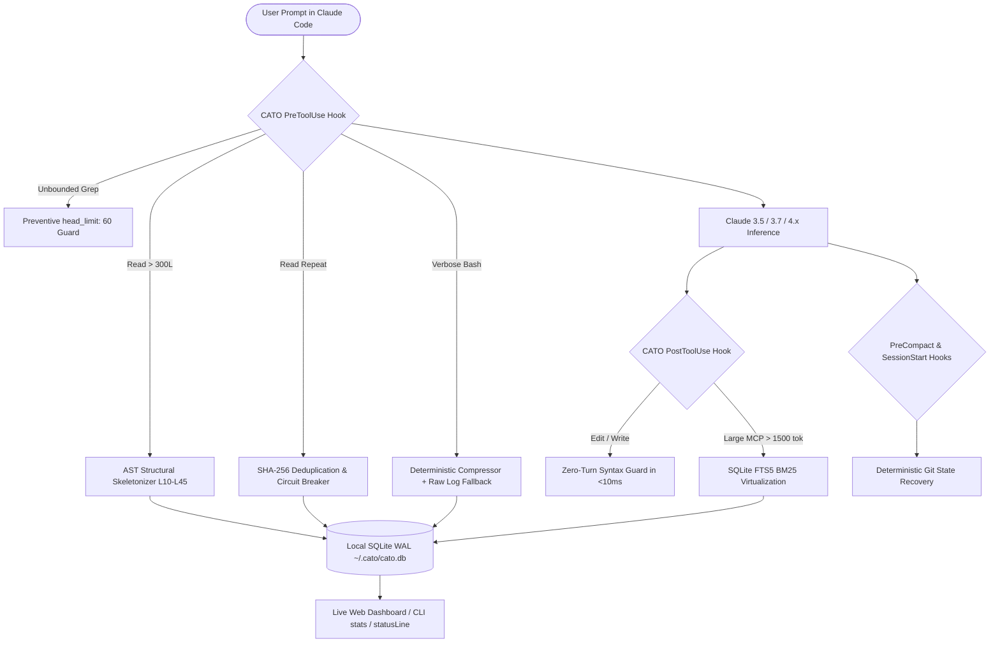

# ⚡ CATO (`Claude Adaptive Token Optimizer`)

[](https://opensource.org/licenses/MIT)
[](https://www.python.org/downloads/)
[](pyproject.toml)
[](https://docs.anthropic.com/en/docs/agents-and-tools/claude-code/overview)
[](tests/test_cato.py)
[](CONTRIBUTING.md)

> **[🇧🇷 Versão em Português disponível aqui](README.pt-BR.md)**

**CATO** is a zero-dependency, cache-preserving token optimization toolkit for the official **Claude Code CLI** (`claude.exe`) and **Claude Desktop (Code mode)**. Operating across **6 deterministic layers**, CATO intercepts token waste at the source before inference occurs, saving **70% to 90% of unnecessary tokens** while preserving 100% of Anthropic's Prompt Cache efficiency (`cache_read_input_tokens` billed at 0.1x).

---

## 📑 Table of Contents

- [The Problem: Token Waste in AI Coding Agents](#-the-problem-token-waste-in-ai-coding-agents)
- [How CATO Works: The 6-Layer Architecture](#-how-cato-works-the-6-layer-architecture)
- [Tracking Your Token Savings (4 Real-Time Views)](#-tracking-your-token-savings-4-real-time-views)
- [Quickstart & Installation](#-quickstart--installation)
- [CLI Reference](#-cli-reference)
- [How CATO Preserves Anthropic Prompt Caching](#-how-cato-preserves-anthropic-prompt-caching)
- [Automated Testing](#-automated-testing)
- [Contributing](#-contributing)
- [License](#-license)

---

## 🛑 The Problem: Token Waste in AI Coding Agents

When building software with autonomous agents like Claude Code, **up to 90% of billed tokens are deterministic waste**:
1. **Blind Whole-File Reads:** Claude calls `Read` on a 2,500-line file (~40,000 tokens) simply to inspect a 15-line method signature.
2. **Redundant Repeated Reads:** The agent re-reads identical unmodified files multiple times in the same session.
3. **Massive Terminal Dumps:** Test runners (`pytest`, `jest`, `vitest`), type checkers (`tsc`), and `git diff` dump thousands of irrelevant passing lines and minified bundles into the active context window.
4. **Oversized MCP Payloads:** MCP servers return massive JSON blobs containing tens of thousands of tokens.
5. **Turn-Wasting Syntax Errors:** A minor typo introduced during `Edit` requires an entire follow-up inference round-trip just for a compiler bash command to report the syntax error.

**CATO intercepts and eliminates each of these inefficiencies deterministically** using official Claude Code lifecycle hooks, with zero quality degradation and sub-10ms execution latency.

---

## 🏗️ How CATO Works: The 6-Layer Architecture



### The 6 Core Layers

| Layer | Module | Description | Typical Savings |
| :--- | :--- | :--- | :--- |
| **1. Session & Subagent** | `config_manager.py` | Idempotent merge into `.claude/settings.json`, Haiku subagent (`cato-explorer.md`), and modular efficiency rules. | **30%–50%** fixed session overhead |
| **2. Terminal Compressor** | `parsers.py` & `runner.py` | Deterministic filtering of test suites (`pytest`, `jest`, `vitest`), linters (`tsc`, `ruff`), `git diff`, and ANSI progress bars with raw log backup in `~/.cato/logs/`. | **75%–95%** in terminal output |
| **3. AST Skeleton & Dedup** | `ast_skeleton.py` & `dedup.py` | Session-scoped SHA-256 deduplicator + AST structural skeleton with line numbers (`[L10-L45]`), with automatic Circuit Breaker on repeated attempts. | **70%–85%** in code file reads |
| **4. PageRank Codebase Map** | `repomap.py` & `server.py` | Pure-Python *Personalized PageRank* dependency graph map and surgical symbol extractor via native stdio JSON-RPC 2.0 MCP server (`cato_repo_map`, `cato_read_symbol`). | **70%–90%** in codebase exploration |
| **5. Syntax Guard & Sandbox** | `post_tool_use.py` & `session_lifecycle.py` | Zero-turn syntax check in <10ms post-edit, SQLite FTS5 (BM25) payload virtualization for massive MCP responses, and pre-compact Git state preservation. | **80%–95%** in MCP outputs & post-compact |
| **6. Telemetry & Dashboard** | `dashboard.py` | Real-time live web dashboard (`cato dashboard`), CLI reporter (`cato stats`), live terminal ray (`cato watch`), 1-line `statusLine` widget, and Claude session JSONL cache hit analyzer. | Full real-time observability |

---

## 📊 Tracking Your Token Savings (4 Real-Time Views)

CATO records every intervention into a local SQLite database (`~/.cato/cato.db`) and provides **4 simultaneous ways** to view your token and dollar savings:

### 1. Live Web Dashboard
```bash
cato dashboard
```
Launches a lightweight local HTTP server at `http://127.0.0.1:8765` featuring:
- **Today's Savings Card** (tokens and direct dollar savings in Opus/Sonnet).
- **All-Time Cumulative Savings Card**.
- **Real Anthropic Prompt Cache Hit Rate (%)** scanned directly from Claude Code session `.jsonl` files.
- **Daily History Table** with comparative progress bars.
- **Intervention Feed in Real Time**.
*(Also automatically generates a standalone static HTML dashboard at `~/.cato/dashboard.html`)*.

### 2. Terminal CLI Stats
```bash
cato stats
```
```text
============================================================
  ⚡ CATO STATS — Real Token Savings Telemetry
============================================================
  📅 TODAY (27/10/2026):
     • Interventions Today  : 2x
     • Raw Tokens Today     : 46,557 -> 1,389 delivered
     • Tokens Saved Today   : -45,168 tokens (-97.0%)
     • Direct Savings Today : $0.1355 (Sonnet $3/1M) | $0.6775 (Opus $15/1M)
------------------------------------------------------------
  🌎 ALL-TIME CUMULATIVE:
     • Total Interventions  : 4x
     • Raw Tokens Total     : 66,691 -> 5,332 delivered
     • Total Tokens Saved   : -61,359 tokens (-92.0%)
     • Direct Savings Total : $0.1841 (Sonnet $3/1M) | $0.9204 (Opus $15/1M)
     • Prompt Cache Hit Rate: 99.1% (41,766,554 unique tokens read at 0.1x)
     • Visual HTML Dashboard: C:\Users\user\.cato\dashboard.html
------------------------------------------------------------
  📆 Daily History (CATO):
    • 27/10/2026 [TODAY] |   2x | -  45,168 tok (46,557 -> 1,389) | $0.6775
    • 26/10/2026        |   2x | -  16,191 tok (20,134 -> 3,943) | $0.2429
============================================================
```

### 3. Live Terminal Watch Mode
```bash
cato watch
```
Leave this running in a split terminal pane alongside your Claude Code session. Every time Claude reads a file slice, runs a test, or triggers an optimization, a real-time event jumps onto your screen!

### 4. Native Claude Code StatusLine
```bash
cato statusline
# Outputs a 1-line string designed for Claude Code's native "statusLine" setting:
# ⚡ CATO Today: -45.2k tok | All-Time: -61.4k tok ($0.92 saved) | Cache Hit: 99%
```

---

## 🚀 Quickstart & Installation

### Requirements
- Python `>= 3.10`
- Claude Code CLI installed (`claude`)

### 1. Install CATO
```bash
pip install git+https://github.com/marcusaguiarmaciel-cmd/cato.git
```
*(Or clone and install locally via `pip install -e .`)*

### 2. Initialize CATO

* **Globally for all current and future projects (Recommended):**
  ```bash
  cato init --global
  ```
* **Or inside a specific project directory only:**
  ```bash
  cato init
  ```
*(CATO automatically performs a non-destructive merge into `.claude/settings.json`, preserving existing user settings, models, and statuslines while creating an automated backup)*.

### 3. Run Diagnostic Check
```bash
cato doctor
```

That's it! When you launch Claude Code (`claude`) or open Claude Desktop (Code mode), CATO runs seamlessly in the background.

---

## 💻 CLI Reference

| Command | Description |
| :--- | :--- |
| `cato init [--global]` | Non-destructively installs hooks, rules, MCP server, and Haiku subagent. |
| `cato doctor` | Audits `.claude/settings.json`, permissions, and project token health. |
| `cato stats [--reset]` | Displays detailed token savings for Today and All-Time. |
| `cato watch` | Real-time live monitor streaming interventions as Claude works. |
| `cato dashboard [--port 8765]` | Launches live auto-refreshing web dashboard server. |
| `cato statusline` | Outputs 1-line compact status string for Claude Code's footer. |
| `cato repomap [--focus QUERY] [--budget TOKENS]` | Generates AST repository map ranked by Personalized PageRank. |
| `cato symbol <FILE> <SYMBOL>` | Surgically extracts exact source lines of a class, function, or method. |
| `cato skeleton <FILE>` | Extracts structural AST skeleton with exact line ranges `[L<start>-L<end>]`. |
| `cato search-sandbox <ID> <QUERY>` | Queries virtualized MCP payloads using SQLite FTS5 BM25 search. |

---

## 🧠 How CATO Preserves Anthropic Prompt Caching

Many prompt compression tools inadvertently harm cost efficiency because they mutate system prompts or inject dynamic timestamps at the beginning of the context. This invalidates Anthropic's **Prompt Cache Prefix**, forcing subsequent turns to be charged at full uncached input rates (1.0x) instead of cache read rates (0.1x).

CATO was engineered with **strict cache-prefix preservation**:
1. **Static System Directives:** Rules and agent configurations remain strictly deterministic and stable across turns.
2. **Dynamic Suffix Interventions:** All AST skeletonizing, slice guarding, and terminal filtering occur exclusively inside tool response payloads (`Read`, `Bash`, `MCP`), which reside in the dynamic message suffix. As a result, the preceding conversation prefix remains 100% hot in the Anthropic cache.

---

## 🧪 Automated Testing

CATO includes a comprehensive test suite covering all 6 layers:
```bash
python -m unittest discover -s tests -v
```
All **12 unit tests** execute in under 2 seconds on standard hardware with zero external test runner dependencies.

---

## 🤝 Contributing

Contributions are warmly welcomed! Please read our [Contributing Guide](CONTRIBUTING.md) and [Code of Conduct](CODE_OF_CONDUCT.md).

1. Fork the repository.
2. Create your feature branch (`git checkout -b feature/amazing-feature`).
3. Commit your changes (`git commit -m 'feat: add amazing feature'`).
4. Ensure all tests pass (`python -m unittest discover -s tests -v`).
5. Push to the branch (`git push origin feature/amazing-feature`).
6. Open a Pull Request.

---

## 📄 License

This project is licensed under the **MIT License** — see the [`LICENSE`](LICENSE) file for details.

Created and engineered by **[Marcus Maciel](https://github.com/marcusaguiarmaciel-cmd)** (2026).
