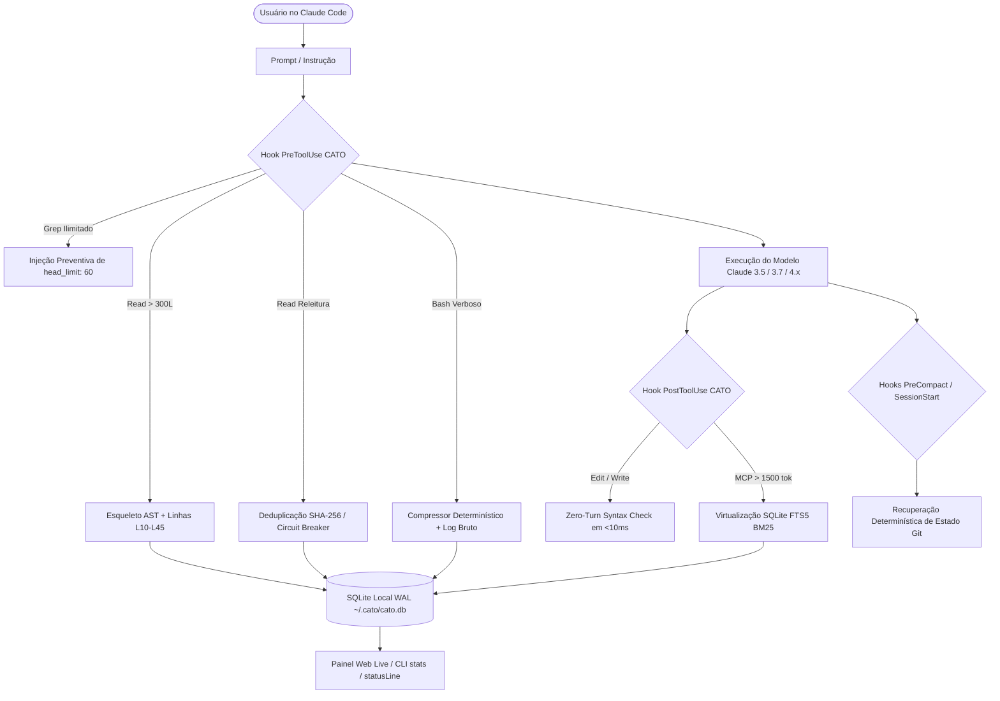

# ⚡ CATO (`Claude Adaptive Token Optimizer`)

[](https://opensource.org/licenses/MIT)
[](https://www.python.org/downloads/)
[](pyproject.toml)
[](https://docs.anthropic.com/en/docs/agents-and-tools/claude-code/overview)
[](tests/test_cato.py)

> **[🇺🇸 English version available here](README.md)**

Kit completo de engenharia de contexto e redução determinística de tokens para o executável oficial do **Claude Code** (`claude.exe`) e **Claude Desktop (modo Code)**, operando em **6 Camadas Modulares** com **zero dependências externas obrigatórias** e preservando 100% do *Prompt Cache* da Anthropic (`cache_read_input_tokens` cobrados a 0.1x).

---

## 📑 Índice

- [Por Que o CATO Existe?](#-por-que-o-cato-existe)
- [Arquitetura em 6 Camadas](#-arquitetura-em-6-camadas)
- [Onde Ver Quantos Tokens Foram Salvos (4 Formas)](#-onde-ver-quantos-tokens-foram-salvos)
- [Instalação Rápida](#-instalação-rápida)
- [Referência de Comandos da CLI](#-referência-de-comandos-da-cli)
- [Como o CATO Preserva o Prompt Cache](#-como-o-cato-preserva-o-prompt-cache)
- [Testes Automatizados](#-testes-automatizados)
- [Licença](#-licença)

---

## 🎯 Por Que o CATO Existe?

Ao trabalhar com agentes como Claude Code em repositórios médios e grandes, **70% a 90% dos tokens consumidos são puro desperdício determinístico**:
1. **Leituras Cegas de Arquivos:** Claude lê um arquivo de 2.000 linhas (~30.000 tokens) apenas para inspecionar a assinatura de um método de 10 linhas.
2. **Releituras Redundantes:** O agente relê o mesmo arquivo inalterado várias vezes na mesma sessão.
3. **Despejo Massivo de Terminal:** Comandos como `pytest`, `jest`, `tsc` e `git diff` despejam milhares de linhas de testes que passaram ou minificados desnecessários no contexto.
4. **Respostas MCP Gigantescas:** Chamadas de ferramentas MCP despejam megabytes de JSON bruto no contexto.
5. **Erros de Sintaxe Desperdiçando Turnos:** Um pequeno erro de sintaxe pós-edição exige um turno extra de Bash apenas para o compilador apontar o erro.

O **CATO intercepta cada uma dessas fontes na origem** através dos hooks nativos do Claude Code, reduzindo o consumo de tokens sem qualquer perda de qualidade ou raciocínio.

---

## 🏗️ Arquitetura em 6 Camadas



| Camada | Módulo | O que faz | Economia Típica |
| :--- | :--- | :--- | :--- |
| **1. Configuração & Subagente** | `config_manager.py` | Merge idempotente em `.claude/settings.json`, ativação de subagente Haiku (`cato-explorer.md`) e regras de eficiência. | **30%–50%** sobrecarga fixa |
| **2. Compressor de Terminal** | `parsers.py` & `runner.py` | Filtra saídas de testes (`pytest`, `jest`, `vitest`), compiladores (`tsc`, `ruff`), `git diff` e barras ANSI, salvando log bruto em `~/.cato/logs/`. | **75%–95%** em saídas de terminal |
| **3. Esqueleto AST & Dedup** | `ast_skeleton.py` & `dedup.py` | Deduplicação SHA-256 por sessão + Esqueleto estrutural com números de linha para leituras cegas, com Circuit Breaker na 2ª tentativa. | **70%–85%** em leituras de código |
| **4. Mapa de Repositório PageRank** | `repomap.py` & `server.py` | Grafo de símbolos e arquivos ranqueados por *Personalized PageRank* via servidor MCP stdio nativo zero-dependência (`cato_repo_map` e `cato_read_symbol`). | **70%–90%** em exploração |
| **5. Syntax Check & Virtualização** | `post_tool_use.py` & `session_lifecycle.py` | Valida sintaxe em <10ms pós-edição, virtualiza payloads MCP massivos em SQLite FTS5 (BM25) e recupera estado Git pós-compactação. | **80%–95%** em MCPs e pós-compact |
| **6. Painel & Telemetria** | `dashboard.py` | Dashboard Web em tempo real, monitor ao vivo no terminal (`cato watch`), statusLine de 1 linha e métricas de Prompt Cache dos `.jsonl`. | Visibilidade total em tempo real |

---

## 📊 Onde Ver Quantos Tokens Foram Salvos

O CATO oferece **4 formas simultâneas** de acompanhar suas economias:

### 1. Painel Web Visual em Tempo Real
```bash
cato dashboard
```
Inicia o servidor local em `http://127.0.0.1:8765` com auto-refresh a cada 3s, cartões de economia de **Hoje** e **Geral Acumulado**, estimativa financeira direta em Claude Opus e Sonnet, eficiência do Prompt Cache e histórico diário. Também gera o arquivo estático autônomo em `~/.cato/dashboard.html`.

### 2. No Terminal via CLI
```bash
cato stats
```
Exibe o relatório completo no terminal:
```text
============================================================
  ⚡ CATO STATS — Telemetria Real de Economia de Tokens
============================================================
  📅 HOJE (27/10/2026):
     • Intervenções Hoje  : 2x
     • Tokens Brutos Hoje : 46,557 -> 1,389 entregues
     • Salvos Hoje (CATO) : -45,168 tokens (-97.0%)
     • Economia Hoje ($)  : $0.1355 (Sonnet $3/1M) | $0.6775 (Opus $15/1M)
------------------------------------------------------------
  🌎 NO GERAL (ACUMULADO CATO):
     • Intervenções Geral : 4x
     • Tokens Brutos Geral: 66,691 -> 5,332 entregues
     • Salvos Geral (CATO): -61,359 tokens (-92.0%)
     • Economia Geral ($) : $0.1841 (Sonnet $3/1M) | $0.9204 (Opus $15/1M)
     • Prompt Cache Hit   : 99.1% (41,766,554 tokens lidos a 0.1x)
============================================================
```

### 3. Monitor Ao Vivo no Terminal
```bash
cato watch
```
Deixe rodando em uma aba lateral do terminal enquanto você conversa com o Claude. Cada arquivo lido, comando comprimido ou intervenção pula na tela em tempo real!

### 4. Na Barra de Status do Claude Code
```bash
cato statusline
# Saída de 1 linha ideal para a propriedade "statusLine" do Claude Code:
# ⚡ CATO Hoje: -45.2k tok | Geral: -61.4k tok ($0.92 poupados) | Cache Hit: 99%
```

---

## 🚀 Instalação Rápida

### Pré-requisitos
- Python `>= 3.10`
- Claude Code CLI instalado (`claude`)

### Passo 1: Instalar o pacote
```bash
pip install git+https://github.com/marcusaguiarmaciel-cmd/cato.git
```
*(Ou clone e instale com `pip install -e .`)*

### Passo 2: Inicializar o CATO

* **Para todos os projetos (Recomendado):**
  ```bash
  cato init --global
  ```
* **Ou apenas no repositório atual:**
  ```bash
  cato init
  ```

> [!IMPORTANT]
> **Rode `cato init` em cada máquina, inclusive depois de clonar este repositório.** Os hooks em `.claude/settings.json` e o servidor MCP em `.mcp.json` apontam para os caminhos absolutos do *seu* Python e da *sua* instalação do CATO, por isso esses arquivos são gerados por máquina e, de propósito, **não são commitados** (estão no `.gitignore`). Um clone novo não tem os hooks do CATO até você rodar `cato init`.

### Passo 3: Auditar o ambiente
```bash
cato doctor
```

Pronto! Ao abrir o Claude Code ou Claude Desktop, os hooks e o servidor MCP já estarão ativos protegendo o seu contexto.

---

## 💻 Referência de Comandos da CLI

| Comando | Descrição |
| :--- | :--- |
| `cato init [--global]` | Configura hooks, regras, servidor MCP e subagente Haiku de forma não-destrutiva. |
| `cato doctor` | Audita `.claude/settings.json`, permissões e saúde de tokens do projeto. |
| `cato stats [--reset]` | Exibe o relatório de tokens economizados hoje e no acumulado geral. |
| `cato watch` | Monitor de intervenções em tempo real no terminal (modo raio-x). |
| `cato dashboard [--port 8765]` | Inicia o servidor do painel web com auto-refresh a cada 3s. |
| `cato statusline` | Gera string compacta de 1 linha para o rodapé nativo do Claude Code. |
| `cato repomap [--focus QUERY] [--budget TOKENS]` | Gera o mapa de repositório ranqueado por PageRank. |
| `cato symbol <ARQUIVO> <SIMBOLO>` | Extrai cirurgicamente apenas a função ou classe desejada. |
| `cato skeleton <ARQUIVO>` | Extrai o esqueleto estrutural AST de um arquivo de código com números de linha. |
| `cato search-sandbox <ID> <QUERY>` | Busca via BM25 em payloads MCP virtualizados sem colocá-los no contexto. |

---

## 🧠 Como o CATO Preserva o Prompt Cache

Muitas ferramentas de otimização falham porque alteram o início do prompt do sistema a cada chamada, quebrando o prefixo do *Prompt Cache* da Anthropic e fazendo cada turno ser cobrado a 1.0x (preço cheio) em vez de 0.1x (preço de cache).

O CATO foi arquitetado com **estrita preservação de cache**:
1. **Regras e System Prompts Estáticos:** O CATO não injeta timestamps voláteis nem instruções dinâmicas no prefixo do sistema.
2. **Intervenção Exclusiva nas Ferramentas:** Toda compressão ocorre no conteúdo de retorno das ferramentas (`Read`, `Bash`, `MCP`), que reside no sufixo dinâmico da mensagem, permitindo que o cache da conversa anterior continue 100% quente.

---

## 🧪 Testes Automatizados

O repositório inclui suíte completa de testes automatizados com cobertura de todas as 6 camadas:
```bash
python -m unittest discover -s tests -v
```
Todos os **13 testes unitários** rodam em menos de 2 segundos com zero dependências externas.

---

## 📄 Licença

Distribuído sob a licença **MIT**. Veja [`LICENSE`](LICENSE) para mais detalhes.

Desenvolvido por **Marcus Maciel** (2026).
